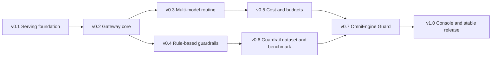

# OmniEngine

[](https://github.com/ell-iothk/omniengine/actions/workflows/ci.yml)

**Observable LLM Inference Platform Powered by vLLM for Agentic API Integration**

> **Status: work in progress.** The repository skeleton, tooling and CI are in place.
> The vLLM serving stack is being built next.

OmniEngine runs one local LLM behind an OpenAI-compatible API so that many agents can share it.
Agents only see `LLM_BASE_URL` and a stable model alias; they never need to know which model is serving.
The first consumer is [analyst-agent](https://github.com/ell-iothk/analyst-agent), a text-to-SQL agent with tool calling.

## Planned features (v0.1)

- Reproducible serving with Docker Compose: vLLM image pinned by digest, model revisions pinned,
  one models folder mounted read-only
- Fits a 6 GB GPU: 4-bit (AWQ) models with tuned context length and GPU memory use
- Reliable tool calling with vLLM tool-call parsers and structured outputs
- Terminal CLI to list, download and switch models, plus an `omniengine smoke` contract test
- Benchmarks (p50/p95 latency, time to first token, tokens per second, VRAM) and a
  tool-calling eval that picks the default model
- Optional monitoring profile: Prometheus and Grafana on vLLM's `/metrics`

## Requirements

- Linux or WSL2, with Python tooling managed by [uv](https://docs.astral.sh/uv/)
- For serving (coming next): an NVIDIA GPU, Docker Engine and the NVIDIA Container Toolkit

## Development

```bash
make setup   # install dependencies from uv.lock and the pre-commit hook
make check   # lint, type check, tests and every pre-commit hook (the same as CI)
make help    # list every target
```

Tests that need a GPU are marked `gpu` and run locally; CI runs on GitHub without a GPU.

## Roadmap

OmniEngine starts as a reproducible vLLM serving stack (v0.1) and grows, one version at a time,
into a self-hosted AI gateway with its own guardrail model and a web console (v1.0).

Only **v0.1** is being built now. The scope of every later version is fixed here; implementation
details are settled when that version starts.

### How versions work

- `0.x` versions add features. Each version builds only on earlier ones and keeps every promise
  in [Compatibility rules](#compatibility-rules).
- `1.0` is the first stable release. From then on, breaking changes need a new major version.
- A version is done when its "Done when" list passes on the reference machine and in CI, starting
  from a clean clone.

**Reference machine:** one laptop GPU (NVIDIA RTX 3060 Laptop, 6 GB VRAM), WSL2 Ubuntu and
Docker Engine. Every version must run there.

### At a glance

| Version | Theme | Adds | Status |
| --- | --- | --- | --- |
| v0.1 | Serving foundation | vLLM on a 6 GB GPU, model profiles, terminal CLI, smoke test, benchmark, tool-calling eval, Prometheus and Grafana | In progress |
| v0.2 | Gateway core | Gateway in front of vLLM, per-agent API keys, rate limits, request log, admin API, graceful model switching | Planned |
| v0.3 | Multi-model routing | Several models at once on larger GPUs, one alias per model | Planned |
| v0.4 | Rule-based guardrails | Policy engine, tool-call schema checks, read-only SQL, PII and secret detection, shadow and enforce modes | Planned |
| v0.5 | Cost and budgets | Cost per agent from measured GPU time and energy, budgets and quotas | Planned |
| v0.6 | Guardrail dataset and benchmark | Labeled agent-security dataset, guardrail benchmark, measured baselines | Planned |
| v0.7 | OmniEngine Guard | Small distilled guardrail model on CPU, combined with the rules | Planned |
| v1.0 | Console and stable release | Web console for models, keys, policies, budgets and guardrail review; stability guarantees | Planned |

### Dependencies



An arrow points from a version to one that builds on it. Only direct links are drawn; each
version below lists everything it builds on. Version numbers set the build order: rule-based
guardrails come before cost so that shadow mode starts collecting data for the v0.6 dataset as
early as possible.

### Compatibility rules

These rules hold for every version from the v0.1.0 release on. They are what keeps versions from
conflicting with each other.

1. **The agent contract never breaks.** Agents call an OpenAI-compatible API at the same
   `LLM_BASE_URL` (same host port) and send a model alias. The default alias `local-llm` always
   exists. New behavior is opt-in.
2. **Settings are added, never renamed or removed** before 1.0. Every OmniEngine setting starts
   with `OMNIENGINE_`, so a variable exported by another project in the same shell cannot
   override it, and every host port is a setting. `.env.example` always lists every setting.
3. **CLI first.** Every feature ships with a terminal command. From v0.2 the CLI talks to the
   admin API, and the v1.0 console uses the same admin API, so the two cannot disagree.
4. **Control and observation stay apart.** Commands and the console change the system; Prometheus
   and Grafana show how it behaves. The console links to Grafana instead of redrawing charts.
5. **The GPU belongs to the LLM engine.** The gateway, rule checks and the guard model run on CPU.
   The only other GPU user is guard model training, which stops the engine first. Benchmarks and
   cost calibration run through the engine while agent traffic is paused.
6. **Everything is pinned.** Image digests, model revisions and dataset versions are pinned, and
   every report records them.
7. **Private by default.** Request content is stored only when enabled per key, is redacted when
   stored, and is never committed or published.
8. **Data survives upgrades.** Stored data (keys, routes, policies, budgets, logs) lives in one
   named volume, changes only through migrations, and is written only by the gateway.

### v0.1: Serving foundation (in progress)

**Goal:** serve one 4-bit model on the 6 GB GPU reliably enough for agents with tool calling, and
prove it with measurements.

**Adds**

- Docker Compose stack: the vLLM image pinned by digest, a health check, and a named volume for
  the compile cache.
- One models folder (`OMNIENGINE_MODELS_DIR`), mounted read-only, with every model pinned to a
  Hugging Face revision.
- Model profiles (Qwen3-4B-AWQ, Qwen3.5-4B AWQ, SAP-4B, xLAM optional) with tested parsers, flags
  and context length.
- Terminal CLI: `omniengine models list`, `models pull`, `serve` (a numbered menu when no model is
  given), `smoke`, `bench` and `eval`.
- Contract smoke test: health, model list, chat, tool calling and structured outputs.
- Benchmark on top of `vllm bench serve`: p50/p95 latency, time to first token, tokens per second
  and peak VRAM, with environment metadata.
- Tool-calling eval that picks the default model.
- Monitoring profile: Prometheus and a Grafana dashboard based on vLLM's official example.

**Done when:** a clean clone serves the default model with `make setup` and `make up`; smoke,
benchmark and eval reports are committed; analyst-agent works through `LLM_BASE_URL`.

### v0.2: Gateway core

**Goal:** put an OmniEngine gateway in front of vLLM so every request is identified, limited and
logged, without changing any agent.

**Adds**

- **Gateway service** (Python, FastAPI, streaming proxy) on the public port. vLLM moves to the
  internal Docker network and no longer has a host port.
- **API keys per agent:** `omniengine keys create|list|revoke`, stored hashed. Keys are enforced
  as soon as one key exists or `OMNIENGINE_API_KEY` is set; the v0.1 key keeps working as the
  default agent's key.
- **Rate and concurrency limits per key** (requests and tokens per minute), answered with 429 and
  `Retry-After`.
- **Request log:** metadata for every request (time, agent, alias, profile, token counts, latency,
  status). Content only when enabled per key, redacted, and kept for a set number of days.
- **Admin API** on a separate port bound to localhost and protected by an admin token. The CLI
  moves onto it with the same command names and options.
- **Engine supervisor** inside the vLLM container (a thin image built locally on the pinned vLLM
  digest). It starts and restarts vLLM processes on request, so switching models never needs
  access to the Docker socket.
- **Graceful model switching and maintenance mode:** in-flight requests finish, new ones wait
  while the next model loads, and requests that wait past the hold limit get 503 with
  `Retry-After`. `omniengine maintenance on|off` uses the same path.
- **Gateway metrics** on `/metrics`: requests, latency split into gateway and engine time, errors
  and limit hits per agent and alias, plus a Grafana panel.
- **Store:** SQLite with migrations in the `omniengine-data` volume.

**Builds on:** v0.1.

**Stays compatible:** same port, same alias, same API; agents without a key keep working until
keys are turned on.

**Done when:** analyst-agent runs through the gateway unchanged; gateway overhead stays under
5 ms at p95 (target); a model switch under load causes no errors other than 503 with
`Retry-After`.

### v0.3: Multi-model routing

**Goal:** run several models at once when the hardware allows it, each behind its own alias.

**Adds**

- **Slots:** the supervisor runs several vLLM processes, each on its own GPU or on a fixed share
  of one (`gpu_memory_utilization` shares that add up to less than 1.0).
- **Routing table:** alias → model profile → slot, managed with `omniengine routes list|set`.
  `/v1/models` lists aliases only.
- **Capacity-aware `serve`:** adds the model to a free slot when it fits, otherwise swaps after a
  confirmation (`--replace` skips the prompt).
- Health, metrics and logs per slot.

**Builds on:** v0.2 (gateway, supervisor, store).

**Stays compatible:** with one slot, the 6 GB default, behavior is the same as v0.2; `local-llm`
always maps to a slot.

**Done when:** two small models share the 6 GB GPU in two slots and both answer through their
aliases; routes survive restarts.

### v0.4: Rule-based guardrails

**Goal:** stop the most common agent failures with deterministic checks, and start measuring what
gets through.

**Adds**

- **Policy engine:** policies in YAML files under `policies/`, assigned per key. Every check has
  an action (`allow`, `flag`, `redact` or `block`) and a mode (`shadow` only records, `enforce`
  acts).
- **Input checks:** prompt size limits; PII detection and redaction (email addresses, phone
  numbers, Indonesian NIK, payment card numbers); secret patterns such as API keys and tokens;
  known injection phrases as a weak baseline that the v0.7 model replaces.
- **Tool-call checks:** arguments validated against the JSON Schema the agent declared in
  `tools`; tool allow-lists per key; SQL checks with a SQL parser (read-only, a single statement,
  allowed tables) for SQL tools such as analyst-agent's.
- **Streaming:** tool-call deltas are buffered until complete, checked, then sent. Text streams
  are either checked after they finish (`audit`) or held until complete (`buffer`), set per
  policy.
- **Blocked requests** return an OpenAI-style error (`type: guardrail_violation`, the category
  and a request id) that agents can handle.
- **Audit log** of every decision, metrics per check, category and action, and
  `omniengine guard test` to run a policy on a sample request and explain the result.

**Builds on:** v0.2 (request pipeline, keys, log).

**Stays compatible:** a key without a policy gets no checks; new policies start in shadow mode.

**Done when:** analyst-agent's eval scenarios pass in enforce mode with no false blocks; a suite
of unsafe SQL and malformed tool calls is blocked; added latency stays under 5 ms at p95
(target).

### v0.5: Cost and budgets

**Goal:** know what each agent costs on self-hosted hardware, in money and GPU time, and cap it.

**Adds**

- **Calibration:** `omniengine cost calibrate` reuses the benchmark to measure GPU seconds per
  1,000 prompt tokens and per 1,000 generated tokens, per profile and slot size, while sampling
  GPU power through NVML. It runs in maintenance mode so agent traffic does not skew it.
- **Cost model:** energy (measured power × electricity tariff) plus hardware amortization (price
  ÷ expected lifetime hours). Tariff, price, lifetime and currency are settings.
- **Cost per request** from its token counts and the calibration, so batching on the GPU does not
  distort it; attributed per agent, alias and profile.
- **Reconciliation:** metered energy per hour against the sum of request estimates; idle time
  reported on its own line; drift above a set threshold asks for recalibration.
- **Budgets and quotas per key** in money, GPU seconds or tokens, per day or month. A soft limit
  warns through a response header and a metric; a hard limit answers 429.
- **Reports:** `omniengine cost report`, cost metrics and a Grafana cost panel, with an optional
  comparison against cloud API prices that the user enters (no built-in price list).

**Builds on:** v0.1 (benchmark), v0.2 (keys, log, maintenance mode), v0.3 (slots).

**Stays compatible:** budgets are opt-in per key.

**Done when:** estimated and metered energy agree within 10% over a day of mixed traffic
(target); a hard budget stops an agent with a clear 429.

### v0.6: Guardrail dataset and benchmark

**Goal:** build the data and the yardstick that the guardrail model needs, before training
anything.

**Adds**

- **Taxonomy and labeling guide:** `safe`, `prompt_injection` (direct), `indirect_injection`
  (inside tool results or retrieved data), `jailbreak`, `data_exfiltration`,
  `destructive_action` and `sensitive_data`. Labels are multi-label and cover two surfaces: input
  (messages and tool results) and action (proposed tool calls).
- **Dataset:** benign agent traffic from the v0.1 eval scenarios and synthetic variants of it;
  synthetic attacks per category, including injections planted in database rows and tool
  outputs; public datasets whose licenses allow training and redistribution; private shadow-mode
  logs (opt-in, redacted) used locally only.
- **Labels:** a larger teacher LLM labels every example with a rubric. It runs through an API or
  on rented GPU time, since it does not fit the reference GPU, and its terms of use must allow
  training on its outputs. A person reviews a stratified sample, and teacher-human agreement is
  reported.
- **Splits:** train, dev and test, with whole attack families kept out of training to test
  generalization.
- **Benchmark:** `omniengine guard eval` scores any guard (rules, an LLM judge or a model) on
  precision, recall and F1 per category, false positive rate on benign agent traffic, and CPU
  latency.
- **Baselines:** the v0.4 rules, the served LLM prompted as a judge, and an existing open-source
  prompt-injection classifier.
- **Publishing:** the public part (synthetic and permissively licensed data) on Hugging Face
  Datasets with a dataset card; a small subset runs in CI against the guards that run on CPU.

**Builds on:** v0.1 (eval scenarios), v0.4 (checks, shadow logs).

**Done when:** the dataset is versioned and published, and the baselines are measured and
committed.

### v0.7: OmniEngine Guard

**Goal:** a small guardrail model trained on agent traffic, fast enough to check every request
on CPU.

**Adds**

- **Model:** a small encoder classifier (candidates such as ModernBERT or DeBERTa-v3 class
  models, picked with the v0.6 benchmark). One multi-label model covers both surfaces, with a
  surface marker in its input.
- **Distillation:** trained on the teacher's soft labels plus the human-reviewed labels, with
  calibrated probabilities so that a threshold means the same thing in every category. Training
  runs on the reference GPU with the engine stopped (rule 5), or on rented GPU time.
- **Serving:** exported to ONNX, quantized to int8 and served on CPU by a `guard` service in its
  own Compose profile. Long inputs are checked in windows.
- **Integration:** a `model` check type in the v0.4 policy engine, with thresholds per category
  and per key. Rules keep the hard limits and the model adds risk scores. Rollout goes to shadow
  mode first, then to enforce, key by key.
- **Failure handling:** if the guard service is down, model checks on tool calls fail closed and
  model checks on inputs fail open with an alert (both configurable); rule checks keep running.
- **Cost:** guard CPU time joins the v0.5 cost model.
- **Release:** weights and a model card (data, metrics, limitations, intended use) on Hugging
  Face, under a license that matches the base model and the data.

**Builds on:** v0.4 (policy engine), v0.5 (cost model), v0.6 (dataset, benchmark, baselines).

**Stays compatible:** model checks are opt-in per policy; rule-only policies behave as in v0.4.

**Done when (targets):** on the held-out test set it beats the v0.4 rules on recall in every
attack category while keeping false positives on benign agent traffic at or below 1%; p95
latency is at or below 30 ms per 512-token window on the reference CPU; a shadow run on
analyst-agent traffic confirms the false positive rate.

### v1.0: Console and stable release

**Goal:** one place to operate OmniEngine, and a release others can depend on.

**Adds**

- **Web console,** served by the gateway on the admin port and built on the same admin API as
  the CLI (server-rendered pages, no separate frontend build):
  - Models: available models, pull, serve or swap, switch status.
  - Agents and keys: create and revoke keys, limits, budgets and assigned policies.
  - Guardrails: policies, shadow or enforce per check, and a review queue where flagged decisions
    are confirmed or marked as false positives. Reviewed decisions become labels for the next
    guard model.
  - Cost: totals per agent and budget status, with links to the Grafana panels.
- **Stability:** semantic versioning from 1.0 and a documented upgrade path with migrations.
- **Images:** gateway and guard images on GitHub Container Registry, pinned by digest. The engine
  image stays a thin layer built locally on the pinned vLLM image.
- **Docs:** architecture, operations guide, security notes, and a results page with the
  benchmark, eval and guard numbers.

**Builds on:** every earlier version.

**Done when:** every console action also works from the CLI, and the reverse; an upgrade from
v0.7 keeps all stored data; a clean clone reaches a working gateway with guardrails on the
reference machine.

### After 1.0

- Regular guard model updates trained on decisions reviewed in the console.
- More policy templates for common kinds of agents.

### Not planned

- A hosted multi-tenant service, or clustering across machines.
- Provider fallback inside the gateway: agents keep their own fallback, as decided in v0.1.
- Fine-tuning the served LLMs: only the small guard model is trained.
- Metric charts in the console: Grafana stays the place for metrics.

## License

The code in this repository is released under the [MIT License](LICENSE).
Model weights are not part of this repository and keep their own licenses.
