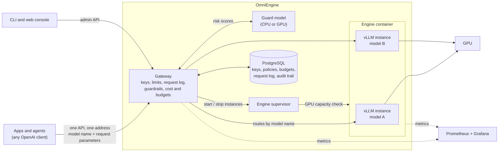
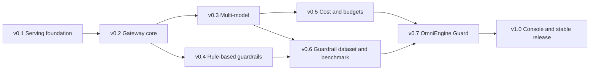
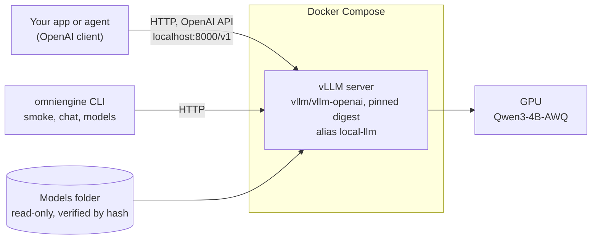

# OmniEngine

[](https://github.com/ell-iothk/omniengine/actions/workflows/ci.yml)

**Self-Hosted LLM Gateway for Agentic Apps, Powered by vLLM**

OmniEngine is a self-hosted AI gateway for local LLMs. Apps and agents send requests to one
OpenAI-compatible API, the same way they would call a cloud model, and OmniEngine takes care of
everything behind it: which model runs where, GPU memory, KV cache, parsers, keys, limits,
guardrails and cost.

This README has two parts:

- **[Part 1: OmniEngine when finished](#part-1-omniengine-when-finished)**: what the project
  becomes and how it works, version by version.
- **[Part 2: What works today (v0.1)](#part-2-what-works-today-v01)**: what is built now, with
  a demo, a quickstart and measured numbers.

> **Status: v0.1 (alpha).** One local model served with vLLM on a 6 GB laptop GPU, checked like
> an agent would use it, and ready to demo from the terminal. Everything else in Part 1 is planned.

## Part 1: OmniEngine when finished

### The problem it solves

Running a model locally is easy to start and hard to share. Every app that talks to vLLM
directly has to know the model name, the context limit, how tool calls and thinking come back,
and what happens when the GPU is full; nothing stops one app from flooding the server, leaking
data through a tool call, or running up GPU time nobody can account for. OmniEngine puts one
gateway in front of the engine so that apps only see a stable API, and the operator controls
models, safety and cost in one place.

### How it works



What happens to one request:

1. An app sends an OpenAI-style request to the gateway: a model name, the messages, and any
   per-request parameters such as `temperature`, `tools` or `response_format`.
2. The gateway checks the app's key and limits, then runs the input guardrails: deterministic
   rules plus the small Guard model, on CPU or GPU.
3. It routes the request to the vLLM instance that serves that model. Engine settings (GPU
   memory, context length, parsers, offload) belong to the instance and are never taken from
   requests.
4. The answer streams back through the gateway, which checks tool calls before they reach the
   app, records the request in PostgreSQL, and adds its GPU time to the app's cost and budget.

The operator manages instances from the CLI or the web console through the same admin API: add a
model at any time, start or stop its instance (a start that does not fit on the GPU is refused),
and watch everything in Grafana. Every admin action and every guardrail decision is written to an
append-only audit trail in PostgreSQL. Prometheus only keeps numbers over time (request rates,
latency, GPU memory) for the Grafana charts; it is not where audit data lives.

### What it will do

| Capability | What it means | Version |
| --- | --- | --- |
| Reproducible vLLM serving | pinned image and model revisions, verified model files, measured settings | v0.1 |
| Contract checks and terminal chat | `smoke` checks the API like an agent; `chat` demos the model | v0.1 |
| One front door | an OpenAI-compatible gateway; apps never talk to vLLM directly | v0.2 |
| Keys, limits and request log | per-app keys, rate limits, request metadata | v0.2 |
| Audit trail | who did what and when: every admin action (v0.2) and guardrail decision (v0.4) | v0.2 |
| Model instances | one `vllm serve` per model, defined by the operator, added at any time | v0.2 |
| Monitoring | Prometheus and Grafana for engine and gateway | v0.2 |
| Several models at once | instances side by side after a GPU capacity check; more models; benchmark and eval | v0.3 |
| Rule-based guardrails | tool-call schema checks, read-only SQL, PII and secret detection | v0.4 |
| Cost and budgets | cost per app from measured GPU time and energy, with budgets | v0.5 |
| Guardrail dataset | labeled agent-security data and a guardrail benchmark | v0.6 |
| OmniEngine Guard | a small distilled guardrail model that runs on CPU or GPU | v0.7 |
| Web console | models, keys, policies, budgets and guardrail review in a browser | v1.0 |

### Roadmap


OmniEngine is built one version at a time: v0.1 is a reproducible vLLM serving stack, and each
later version adds one layer of the full picture above, up to the web console in v1.0.

Only **v0.1** is being built now. Its scope was narrowed on purpose: it shows that the project
deploys a model with vLLM and can be demoed. The scope of every later version is fixed here;
implementation details are settled when that version starts.

#### How versions work

- `0.x` versions add features. Each version builds only on earlier ones and keeps every promise
  in [Compatibility rules](#compatibility-rules).
- `1.0` is the first stable release. From then on, breaking changes need a new major version.
- A `0.x` version is done when its "Done when" list passes: CI is green, `make check` passes from
  a clean clone, and the version's checks pass against the real server on the reference machine.
  The full clean-clone run on the reference machine, from `git clone` to a serving model, is part
  of the v1.0 release.

**Reference machine:** one laptop GPU (NVIDIA RTX 3060 Laptop, 6 GB VRAM), WSL2 Ubuntu and
Docker Engine. Every version must run there.

#### At a glance

| Version | Theme | Adds | Status |
| --- | --- | --- | --- |
| v0.1 | Serving foundation | vLLM on a 6 GB GPU, terminal CLI, smoke test, terminal chat demo | Released |
| v0.2 | Gateway core | Gateway in front of vLLM as the single front door, model instances, per-agent API keys, rate limits, request log, admin API with an audit trail, PostgreSQL store, Prometheus and Grafana | Planned |
| v0.3 | Multi-model | Several model instances at once with a GPU capacity check, more models, benchmark, tool-calling eval | Planned |
| v0.4 | Rule-based guardrails | Policy engine, tool-call schema checks, read-only SQL, PII and secret detection, shadow and enforce modes | Planned |
| v0.5 | Cost and budgets | Cost per agent from measured GPU time and energy, budgets and quotas | Planned |
| v0.6 | Guardrail dataset and benchmark | Labeled agent-security dataset, guardrail benchmark, measured baselines | Planned |
| v0.7 | OmniEngine Guard | Small distilled guardrail model on CPU or GPU, combined with the rules | Planned |
| v1.0 | Console and stable release | Web console for models, keys, policies, budgets and guardrail review; stability guarantees | Planned |

#### Dependencies



An arrow points from a version to one that builds on it. Only direct links are drawn; each
version below lists everything it builds on. Version numbers set the build order: rule-based
guardrails come before cost so that shadow mode starts collecting data for the v0.6 dataset as
early as possible.

#### Compatibility rules

These rules hold for every version from the v0.1.0 release on. They are what keeps versions from
conflicting with each other.

1. **The agent contract never breaks.** Agents call an OpenAI-compatible API at the same
   `LLM_BASE_URL` (same host port) and send a model alias. The default alias `local-llm` always
   exists. New behavior is opt-in.
2. **Settings are added, never renamed or removed** before 1.0. Every OmniEngine setting starts
   with `OMNIENGINE_`, so a variable exported by another project in the same shell cannot
   override it, and every host port is a setting. `.env.example` always lists every setting.
3. **CLI first.** Every feature ships with a terminal command. From v0.2 the CLI talks to the
   admin API, and the v1.0 console uses the same admin API, so the two cannot disagree.
4. **Control and observation stay apart.** Commands and the console change the system; Prometheus
   and Grafana show how it behaves. The console links to Grafana instead of redrawing charts.
5. **The LLM engine comes first on the GPU.** The gateway and rule checks run on CPU. The guard
   model runs on CPU or on the GPU; on the GPU it counts in the same capacity check as the vLLM
   instances, so it never pushes a model out. Guard model training stops the engine first when
   they share a GPU. Benchmarks and cost calibration run through the engine while agent traffic
   is paused.
6. **Everything is pinned.** Image digests, model revisions and dataset versions are pinned, and
   every report records them.
7. **Private by default.** Request content is stored only when enabled per key, is redacted when
   stored, and is never committed or published.
8. **Data survives upgrades.** Stored data (keys, routes, policies, budgets, logs, audit trail)
   lives in PostgreSQL on one named volume, changes only through migrations, and is written only
   by the gateway. The audit trail is append-only: entries are never changed or deleted.

#### v0.1: Serving foundation (released)

**Goal:** show that the project deploys a model with vLLM on the 6 GB GPU and that it can be
demoed.

**Adds**

- Docker Compose stack: the vLLM image pinned by digest, a health check, and a named volume for
  the compile cache.
- One models folder (`OMNIENGINE_MODELS_DIR`), mounted read-only; the model is pinned to a
  Hugging Face revision and its files are verified by hash.
- Qwen3-4B-AWQ with measured GPU memory and context settings, and the tool-call and reasoning
  parsers.
- Terminal CLI: `omniengine models pull|verify`, `smoke` and `chat`, wrapped by `make` targets.
- Contract smoke test: health, model list, chat, tool calling and structured outputs.
- Terminal chat demo with streamed answers and optional thinking.

**Done when:** CI is green and `make check` passes from a clean clone; `make up`, `make smoke` and
`make chat` work on the reference machine; v0.1.0 is tagged.

#### v0.2: Gateway core

**Goal:** put an OmniEngine gateway in front of vLLM as the single front door, so every request
is identified, limited and logged, without changing any agent.

**Adds**

- **Gateway service** (Python, FastAPI, streaming proxy) on the public port. vLLM moves to the
  internal Docker network and no longer has a host port. Apps send every request here: the model
  name and per-request parameters (temperature, tools, structured output); engine settings are
  never accepted from requests.
- **Model instances:** one `vllm serve` process per model, defined by a file in the repo that
  holds every engine setting (GPU memory, context length, parsers, extra flags). Instances can be
  added at any time; v0.2 runs one at a time and refuses to start a second one. Managed from the
  terminal (`omniengine instances list`, `start`, `stop`, `status`).
- **API keys per agent:** `omniengine keys create|list|revoke`, stored hashed. Keys are enforced
  as soon as one key exists or `OMNIENGINE_API_KEY` is set; the v0.1 key keeps working as the
  default agent's key.
- **Rate and concurrency limits per key** (requests and tokens per minute), answered with 429 and
  `Retry-After`.
- **Request log:** metadata for every request (time, agent, alias, instance, token counts,
  latency, status). Content only when enabled per key, redacted, and kept for a set number of days.
- **Admin API** on a separate port bound to localhost and protected by an admin token. The CLI
  moves onto it with the same command names and options.
- **Audit trail:** every admin API action (time, which admin token, action, target, result,
  including refused actions) in an append-only table. The gateway's database role may insert
  into it but never update or delete. Read with `omniengine audit list`, filterable by time,
  action and target.
- **Engine supervisor** inside the vLLM container (a thin image built locally on the pinned vLLM
  digest). It starts and stops the vLLM instances on request, so the gateway never needs access
  to the Docker socket.
- **Maintenance mode:** in-flight requests finish and new ones get 503 with `Retry-After`;
  `omniengine maintenance on|off`.
- **Monitoring profile:** Prometheus scraping vLLM's and the gateway's `/metrics`, and a Grafana
  dashboard based on vLLM's official example (`docker compose --profile monitoring up`).
- **Gateway metrics:** requests, latency split into gateway and engine time, errors and limit
  hits per agent and alias, plus a Grafana panel.
- **Store:** PostgreSQL in its own container, pinned by digest, on the `omniengine-data` named
  volume; schema changes only through migrations. It holds keys, routes, policies, budgets, the
  request log and the audit trail.

**Builds on:** v0.1.

**Stays compatible:** same port, same alias, same API; agents without a key keep working until
keys are turned on.

**Done when:** analyst-agent runs through the gateway unchanged; gateway overhead stays under
5 ms at p95 (target); starting a second instance is refused with a clear message; Grafana shows
live engine and gateway metrics.

#### v0.3: Multi-model

**Goal:** run several model instances at once when the hardware allows it, add more models, and
choose the default model with data.

**Adds**

- **Instances side by side:** the supervisor runs several vLLM instances in the one container,
  each on its own GPU or on a fixed share of one (`gpu_memory_utilization` shares that add up to
  less than 1.0).
- **GPU capacity check:** starting another instance first checks that the GPU fits all of them;
  when it does not, the start is refused with a clear message (swapping may be designed later).
- **Routing table:** model name or alias → instance, managed with `omniengine routes list|set`.
  `/v1/models` lists names and aliases only.
- **More models:** Qwen3.5-4B AWQ (hybrid attention), SAP-4B (a tool-use specialist), xLAM
  optional (non-commercial license); quantized to 4-bit AWQ with llm-compressor when no usable
  checkpoint exists; LoRA as an off-by-default instance option. Instances for models without
  thinking leave the reasoning parser out.
- **Benchmark** on top of `vllm bench serve`: p50/p95 latency, time to first token, tokens per
  second and peak VRAM, with warm-up, repeats and environment metadata, committed as reports.
- **Tool-calling eval:** chained tool-calling scenarios shaped like analyst-agent; the results
  pick the default model.
- Health, metrics and logs per instance.

**Builds on:** v0.2 (gateway, supervisor, store).

**Stays compatible:** with one instance, the 6 GB default, behavior is the same as v0.2;
`local-llm` always maps to an instance.

**Done when:** two small models share the 6 GB GPU as two instances and both answer through their
names; a third that does not fit is refused; benchmark and eval reports are committed and the
default model is chosen from them.

#### v0.4: Rule-based guardrails

**Goal:** stop the most common agent failures with deterministic checks, and start measuring what
gets through.

**Adds**

- **Policy engine:** policies in YAML files under `policies/`, assigned per key. Every check has
  an action (`allow`, `flag`, `redact` or `block`) and a mode (`shadow` only records, `enforce`
  acts).
- **Input checks:** prompt size limits; PII detection and redaction (email addresses, phone
  numbers, Indonesian NIK, payment card numbers); secret patterns such as API keys and tokens;
  known injection phrases as a weak baseline that the v0.7 model replaces.
- **Tool-call checks:** arguments validated against the JSON Schema the agent declared in
  `tools`; tool allow-lists per key; SQL checks with a SQL parser (read-only, a single statement,
  allowed tables) for SQL tools such as analyst-agent's.
- **Streaming:** tool-call deltas are buffered until complete, checked, then sent. Text streams
  are either checked after they finish (`audit`) or held until complete (`buffer`), set per
  policy.
- **Blocked requests** return an OpenAI-style error (`type: guardrail_violation`, the category
  and a request id) that agents can handle.
- **Every decision goes into the audit trail** (request id, check, category, action, mode),
  with metrics per check, category and action, and `omniengine guard test` to run a policy on a
  sample request and explain the result.

**Builds on:** v0.2 (request pipeline, keys, log).

**Stays compatible:** a key without a policy gets no checks; new policies start in shadow mode.

**Done when:** analyst-agent's eval scenarios pass in enforce mode with no false blocks; a suite
of unsafe SQL and malformed tool calls is blocked; added latency stays under 5 ms at p95
(target).

#### v0.5: Cost and budgets

**Goal:** know what each agent costs on self-hosted hardware, in money and GPU time, and cap it.

**Adds**

- **Calibration:** `omniengine cost calibrate` reuses the benchmark to measure GPU seconds per
  1,000 prompt tokens and per 1,000 generated tokens, per instance and GPU share, while sampling
  GPU power through NVML. It runs in maintenance mode so agent traffic does not skew it.
- **Cost model:** energy (measured power × electricity tariff) plus hardware amortization (price
  ÷ expected lifetime hours). Tariff, price, lifetime and currency are settings.
- **Cost per request** from its token counts and the calibration, so batching on the GPU does not
  distort it; attributed per agent, alias and instance.
- **Reconciliation:** metered energy per hour against the sum of request estimates; idle time
  reported on its own line; drift above a set threshold asks for recalibration.
- **Budgets and quotas per key** in money, GPU seconds or tokens, per day or month. A soft limit
  warns through a response header and a metric; a hard limit answers 429.
- **Reports:** `omniengine cost report`, cost metrics and a Grafana cost panel, with an optional
  comparison against cloud API prices that the user enters (no built-in price list).

**Builds on:** v0.2 (keys, log, maintenance mode), v0.3 (instances, benchmark).

**Stays compatible:** budgets are opt-in per key.

**Done when:** estimated and metered energy agree within 10% over a day of mixed traffic
(target); a hard budget stops an agent with a clear 429.

#### v0.6: Guardrail dataset and benchmark

**Goal:** build the data and the yardstick that the guardrail model needs, before training
anything.

**Adds**

- **Taxonomy and labeling guide:** `safe`, `prompt_injection` (direct), `indirect_injection`
  (inside tool results or retrieved data), `jailbreak`, `data_exfiltration`,
  `destructive_action` and `sensitive_data`. Labels are multi-label and cover two surfaces: input
  (messages and tool results) and action (proposed tool calls).
- **Dataset:** benign agent traffic from the v0.3 eval scenarios and synthetic variants of it;
  synthetic attacks per category, including injections planted in database rows and tool
  outputs; public datasets whose licenses allow training and redistribution; private shadow-mode
  logs (opt-in, redacted) used locally only.
- **Labels:** a larger teacher LLM labels every example with a rubric. It runs through an API or
  on rented GPU time, since it does not fit the reference GPU, and its terms of use must allow
  training on its outputs. A person reviews a stratified sample, and teacher-human agreement is
  reported.
- **Splits:** train, dev and test, with whole attack families kept out of training to test
  generalization.
- **Benchmark:** `omniengine guard eval` scores any guard (rules, an LLM judge or a model) on
  precision, recall and F1 per category, false positive rate on benign agent traffic, and
  latency on CPU and on GPU.
- **Baselines:** the v0.4 rules, the served LLM prompted as a judge, and an existing open-source
  prompt-injection classifier.
- **Publishing:** the public part (synthetic and permissively licensed data) on Hugging Face
  Datasets with a dataset card; a small subset runs in CI against the guards on CPU, since CI
  has no GPU.

**Builds on:** v0.3 (eval scenarios), v0.4 (checks, shadow logs).

**Done when:** the dataset is versioned and published, and the baselines are measured and
committed.

#### v0.7: OmniEngine Guard

**Goal:** a small guardrail model trained on agent traffic, fast enough to check every request
on CPU or GPU.

**Adds**

- **Model:** a small encoder classifier (candidates such as ModernBERT or DeBERTa-v3 class
  models, picked with the v0.6 benchmark). One multi-label model covers both surfaces, with a
  surface marker in its input.
- **Distillation:** trained on the teacher's soft labels plus the human-reviewed labels, with
  calibrated probabilities so that a threshold means the same thing in every category. Training
  runs on the reference GPU with the engine stopped (rule 5), or on rented GPU time.
- **Serving:** exported to ONNX and served by a `guard` service in its own Compose profile, on CPU
  (quantized to int8) or on the GPU when it fits next to the vLLM instances, set per deployment.
  Long inputs are checked in windows.
- **Integration:** a `model` check type in the v0.4 policy engine, with thresholds per category
  and per key. Rules keep the hard limits and the model adds risk scores. Rollout goes to shadow
  mode first, then to enforce, key by key.
- **Failure handling:** if the guard service is down, model checks on tool calls fail closed and
  model checks on inputs fail open with an alert (both configurable); rule checks keep running.
- **Cost:** guard CPU or GPU time joins the v0.5 cost model.
- **Release:** weights and a model card (data, metrics, limitations, intended use) on Hugging
  Face, under a license that matches the base model and the data.

**Builds on:** v0.4 (policy engine), v0.5 (cost model), v0.6 (dataset, benchmark, baselines).

**Stays compatible:** model checks are opt-in per policy; rule-only policies behave as in v0.4.

**Done when (targets):** on the held-out test set it beats the v0.4 rules on recall in every
attack category while keeping false positives on benign agent traffic at or below 1%; p95
latency is at or below 30 ms per 512-token window on the reference CPU, and lower on the GPU;
a shadow run on analyst-agent traffic confirms the false positive rate.

#### v1.0: Console and stable release

**Goal:** one place to operate OmniEngine, and a release others can depend on.

**Adds**

- **Web console,** served by the gateway on the admin port and built on the same admin API as
  the CLI (server-rendered pages, no separate frontend build):
  - Models: add a model instance, pull its model, start or stop it, and see which instances run.
  - Agents and keys: create and revoke keys, limits, budgets and assigned policies.
  - Guardrails: policies, shadow or enforce per check, and a review queue where flagged decisions
    are confirmed or marked as false positives. Reviewed decisions become labels for the next
    guard model.
  - Cost: totals per agent and budget status, with links to the Grafana panels.
  - Audit: the audit trail, filterable by time, actor, action and target.
- **Stability:** semantic versioning from 1.0 and a documented upgrade path with migrations.
- **Images:** gateway and guard images on GitHub Container Registry, pinned by digest. The engine
  image stays a thin layer built locally on the pinned vLLM image.
- **Docs:** architecture, operations guide, security notes, and a results page with the
  benchmark, eval and guard numbers.

**Builds on:** every earlier version.

**Done when:** every console action also works from the CLI, and the reverse; an upgrade from
v0.7 keeps all stored data; a clean clone reaches a working gateway with guardrails on the
reference machine.

#### After 1.0

- Regular guard model updates trained on decisions reviewed in the console.
- More policy templates for common kinds of agents.

#### Not planned

- A hosted multi-tenant service, or clustering across machines.
- Provider fallback inside the gateway: agents keep their own fallback, as decided in v0.1.
- Fine-tuning the served LLMs: only the small guard model is trained.
- Metric charts in the console: Grafana stays the place for metrics.

## Part 2: What works today (v0.1)

### What v0.1 does

- **Serves Qwen3-4B-AWQ with vLLM** in Docker Compose on a 6 GB GPU: the vLLM image is pinned
  by digest, the model by Hugging Face revision, and model files are verified by hash and
  mounted read-only.
- **Speaks the OpenAI API** at `http://localhost:8000/v1` under the alias `local-llm`, with tool
  calls, separated thinking (`reasoning`) and JSON-schema outputs parsed by vLLM.
- **Checks itself like an agent:** `make smoke` tests health, the model list, chat, tool calling
  and structured output against the running server, using the official `openai` client.
- **Demos in the terminal:** `make chat` streams answers from the local model, keeps the
  conversation, and can show the model's thinking.

### Demo

A real session on the reference laptop (answers shortened):

```text
$ make chat
Chatting with local-llm at http://localhost:8000/v1; /exit leaves.
you> apa itu vLLM?
local-llm> ... (a long answer with headings and lists, left out here)
you> ringkas jadi dua kalimat
local-llm> vLLM adalah library open-source yang dirancang untuk mempercepat inferensi model
bahasa besar (LLM) melalui optimisasi efisiensi dan kecepatan. Teknologi ini mendukung aplikasi
real-time seperti chatbot dan asisten AI dengan mengurangi latensi dan memperluas kemampuan skala
komputasi.
you> apa itu agentic AI
local-llm> **Agentic AI** adalah pendekatan AI yang dirancang untuk menghasilkan sistem yang dapat
bertindak secara mandiri, ... dengan kemampuan berpikir, belajar, dan^C
(stopped)
you> /exit
```

The second answer shows that the conversation is kept; Ctrl+C stops one answer without leaving
the chat. With `--show-thinking`, the model's reasoning streams first, then the answer:

```text
$ uv run --env-file .env omniengine chat --show-thinking
you> berapa 17 * 32?
local-llm>
Okay, so I need to calculate 17 multiplied by 32. ... 17*30 is 510, and 17*2 is 34 ...
I can be confident that 17 multiplied by 32 is indeed 544.

Hasil dari 17 × 32 adalah **544**.
```

And the contract check:

```text
$ make smoke
PASS  health   GET http://localhost:8000/health returned 200
PASS  models   local-llm is served
PASS  chat     answered '5' in 1.6 s (118 tokens)
PASS  tools    called run_sql with 'SELECT COUNT(*) FROM customers;'
PASS  json     returned {"answer": 5}
5 of 5 checks passed against http://localhost:8000/v1
```

### Quickstart

**Needs:** Linux or WSL2, an NVIDIA GPU with 6 GB or more, Docker Engine with the NVIDIA
Container Toolkit, [uv](https://docs.astral.sh/uv/), and about 40 GB of free disk (the vLLM
image is 33 GB, the model 2.5 GB).

```bash
git clone https://github.com/ell-iothk/omniengine.git
cd omniengine
make setup                    # Python tooling from uv.lock, plus the git hooks
cp .env.example .env          # then set OMNIENGINE_MODELS_DIR to an absolute folder
make pull-model               # download Qwen3-4B-AWQ if missing, then verify every file hash
make up                       # start vLLM and wait until it is healthy (first start: minutes)
make smoke                    # check it like an agent
make chat                     # talk to it; /exit leaves
make down                     # stop it; models, volumes and the image stay
```

Run `make help` for every target. Only one vLLM server fits on a 6 GB GPU, so stop any other one
before `make up`.

### Use it from your own app

Any OpenAI-compatible client works; only the base URL and the model name change:

```python
from openai import OpenAI

client = OpenAI(base_url="http://localhost:8000/v1", api_key="no-key")
reply = client.chat.completions.create(
    model="local-llm",
    messages=[{"role": "user", "content": "Jawab satu kata: ibu kota Indonesia?"}],
)
print(reply.choices[0].message.content.strip())
```

Set `OMNIENGINE_API_KEY` in `.env` to require a key, and send it as the client's `api_key`.
Requests may set sampling parameters such as `temperature`, `tools` or `response_format`;
engine settings such as GPU memory and context length are fixed by the deployment.

### How v0.1 runs



vLLM runs as a server in its own container; nothing in this repo imports it. The `omniengine`
package and every app talk to it over HTTP, which is why CI can test the checks against a small
fake server without a GPU.

### Measured on the reference laptop

NVIDIA RTX 3060 Laptop GPU (6 GB), WSL2, vLLM 0.32.0, Qwen3-4B-AWQ (4-bit AWQ, Marlin kernels),
thinking on. Single runs, not a benchmark: the benchmark with repeats and spread comes in v0.3.

| What | Value |
| --- | --- |
| GPU memory share | 0.80; 0.85 is refused because only 5.0 GiB of 6 GiB is free at start |
| KV cache | 1.41 GiB = 10,224 tokens, about 145 KB per token |
| Context length | 8,192 tokens; one full request needs 1.12 GiB of KV cache |
| GPU memory in use | 5,330 of 6,144 MiB |
| Chat answer, 118 tokens | 1.6 s, about 74 tokens per second end to end |
| Restart with a warm compile cache | healthy in 57 s |

The measurements behind the GPU memory and context settings are written next to them in
`.env.example`.

### Optional shortcut

`make` targets work on every clone. If you call the CLI directly a lot, an alias in your own
`~/.bashrc` saves typing (adjust the path to where you cloned the repo):

```bash
alias omniengine='uv run --project "$HOME/omniengine" --env-file "$HOME/omniengine/.env" omniengine'
```

Then `omniengine chat --show-thinking` or `omniengine smoke` work from any folder.

### Development

```bash
make setup   # install dependencies from uv.lock and the pre-commit hook
make check   # lint, type check, tests and every pre-commit hook (the same as CI)
make help    # list every target
```

CI runs on GitHub without a GPU: the checks are tested against a fake vLLM server. Tests marked
`gpu` run locally against the real server with `make test-gpu`.

## License

The code in this repository is released under the [MIT License](LICENSE).
Model weights are not part of this repository and keep their own licenses.
